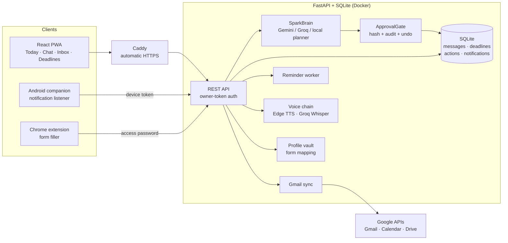

# Spark — your voice-first personal assistant

**wHACKiest 2026 · Track 1 · Team Codex**

Spark reads your real Gmail, Google Calendar and Drive, catches deadlines,
unifies WhatsApp notifications from an Android companion, speaks naturally in
English and Hindi, and fills forms from a browser extension. It can also make
calendar events and Gmail drafts — but **every write waits for your explicit
approval**, is recorded in an audit log, and can be undone.

No seeded messages are shown when Google is connected. Nothing is sent or
submitted behind your back.

---

## What it does

- **Real Google data** — OAuth with Gmail read + compose, Calendar events and
  Drive read scopes. No mocked inbox in live mode.
- **Unified inbox** — Gmail and WhatsApp in one searchable list, with category,
  priority and “needs action” tags.
- **Deadline radar** — extracts dates from message text, shows evidence and
  confidence, and proposes a Calendar reminder that you approve.
- **WhatsApp without a bridge** — an Android `NotificationListenerService`
  forwards notifications even when Spark is closed. No unofficial WhatsApp
  client, no account ban risk, no chat history scraping.
- **Natural voice** — free Edge neural TTS, Groq Whisper STT, Gemini/Groq
  planning, with browser speech as the always-available fallback.
- **Form filling with a real gate** — a Chrome/Edge extension reads the form,
  matches it to your saved profile, fills it, and only submits after you tick
  the approval box. Passwords, OTPs, card numbers and files are never filled.
- **Approval gate + audit + undo** — tool arguments are SHA-256 hashed at
  proposal time and re-verified before execution.
- **One-command cloud deploy** — Docker Compose + Caddy on Oracle Cloud Always
  Free, with HTTPS and nightly SQLite backups.

---

## Architecture



### The write path

1. A read tool may run freely (`calendar.list_events`, `gmail.search_emails`,
   `drive.search_files`).
2. A write becomes a **preview card** through `ApprovalGate.propose()`.
3. The card shows exactly what will change. Arguments are hashed.
4. You tap **Approve**; the hash is re-checked, then the tool executes.
5. **Undo** is available for 24 hours and is itself audited.
6. Web content is treated as data, never instructions. Prompt-injection
   attempts are flagged and surfaced.

Gmail is **draft-only**: Spark can create a draft but never send it. Drive is
read-only.

---

## Quickstart (zero secrets, demo mode)

Prerequisites: Python 3.11+, Node 20+, Git.

```bash
git clone https://github.com/KHarinadhReddy/Spark.git
cd Spark

python -m venv .venv
# Windows PowerShell:
.venv\Scripts\Activate.ps1
# macOS/Linux:
# source .venv/bin/activate

pip install -r backend/requirements.txt

cd frontend
npm install
npm run build
cd ..

# Windows PowerShell
$env:PYTHONPATH = "backend"
.venv\Scripts\python -m uvicorn app.main:app --reload --port 8000

# macOS/Linux
# PYTHONPATH=backend .venv/bin/python -m uvicorn app.main:app --reload --port 8000
```

Open <http://127.0.0.1:8000>. Demo mode uses the seeded student workspace so
you can try the approval gate before connecting any account.

For live frontend development, run `npm run dev` in `frontend/`; Vite proxies
`/api` to port 8000.

---

## Live mode

Copy `.env.example` to `.env` and fill in what you have. The full production
walkthrough is in **[deploy/oracle.md](deploy/oracle.md)**.

### Google (required for real data)

1. Create a project in [Google Cloud Console](https://console.cloud.google.com/).
2. Enable **Gmail API**, **Google Calendar API**, **Google Drive API**.
3. Configure the OAuth consent screen:
   - **Internal** for a Google Workspace account — recommended, long-lived
     refresh tokens.
   - **External** for personal Gmail. Add yourself as a test user; testing-mode
     refresh tokens expire after 7 days until the app is published.
4. Create an OAuth client of type **Web application** with the redirect URI
   `http://localhost:8000/api/auth/google/callback` (or your HTTPS domain).
5. Put the credentials in `.env`:

```env
GOOGLE_CLIENT_ID=...
GOOGLE_CLIENT_SECRET=...
GOOGLE_REDIRECT_URI=http://localhost:8000/api/auth/google/callback
```

Then open Spark → **Settings → Connect Google**.

### Free AI and voice

```env
GEMINI_API_KEY=...          # primary planner, free tier
GROQ_API_KEY=...            # fallback planner + Whisper STT
SPARK_EDGE_TTS=1            # free neural TTS, no key
```

Optional premium voice: set `ELEVENLABS_API_KEY` and it takes priority over
Edge TTS. If no model key exists, Spark still works with a deterministic local
planner and the browser voice.

### Lock it down

On any public URL set a strong access password:

```bash
openssl rand -hex 32
```

```env
SPARK_OWNER_TOKEN=<the generated value>
```

Paste the same token into **Settings → Access** in the web app and into the
browser extension. All API routes except `/api/health`, the Google OAuth
callback and device-token companion routes then require `x-spark-token` (or a
Bearer token). Starting Google OAuth also requires the access password.

---

## Cloud deployment (Oracle Always Free)

The repo ships:

| File | Purpose |
|---|---|
| `Dockerfile` | Frontend build + Python runtime |
| `docker-compose.yml` | API + worker + Caddy + backup service |
| `Caddyfile` | Automatic HTTPS reverse proxy |
| `deploy/oracle.md` | Step-by-step VM, DNS, OAuth, backup and restore guide |

```bash
cp .env.example .env    # fill SPARK_DOMAIN, owner token, Google + AI keys
docker compose up -d --build
docker compose logs -f caddy api worker
```

The API never publishes port 8000; Caddy is the only public entry point. The
API and background worker share a named SQLite volume, and `docker compose
--profile tools run --rm backup` produces a consistent zip snapshot.

---

## Chrome / Edge form filler

See **[extension/README.md](extension/README.md)**.

1. Open `chrome://extensions` (or `edge://extensions`), enable **Developer
   mode**, and choose **Load unpacked** → this repo's `extension/` folder.
2. In the extension's **Settings**, set the backend URL and access password.
3. Open a form, review the matched values, click **Fill form**, check the page,
   tick the approval box, then **Submit form**.

The backend rejects submission with HTTP 403 unless `approved: true`, and logs
every analyzed and submitted form. Sensitive fields (passwords, OTPs, CAPTCHA,
payment data, file uploads) are never filled. A page ultimately controls its
own submit action, so always review before approving.

---

## Android WhatsApp companion

See **[companion/android/README.md](companion/android/README.md)**.

```bash
cd companion/android
./gradlew assembleDebug        # Windows: .\gradlew.bat assembleDebug
adb install -r app/build/outputs/apk/debug/app-debug.apk
```

1. In Spark: **Settings → WhatsApp companion → Pair a device**.
2. Paste the backend URL and one-time device token into the app.
3. Grant **Notification access** to Spark Companion.
4. Send a WhatsApp message; it appears in Spark's Inbox within seconds.

The companion forwards notification text only. It cannot read old chats and
cannot send messages. WhatsApp chat exports can be imported separately from
Settings for history.

---

## API reference

All routes are under `/api`. When `SPARK_OWNER_TOKEN` is set, send
`x-spark-token: <token>` or `Authorization: Bearer <token>`. Device routes use
`x-spark-device: <pairing token>`.

| Endpoint | Method | Description |
|---|---|---|
| `/health` | GET | Mode, capabilities, inbox counts (public) |
| `/config` | GET | Tools, prompts, Google/AI/voice status |
| `/chat` | POST | `{message, language}` → reply, cards, sources, flags |
| `/brief?language=en\|hi` | GET | Morning brief, events, deadlines |
| `/inbox` | GET | Unified messages, filters, stats |
| `/messages/{id}` | GET | Full message body |
| `/messages/{id}/read` | POST | Mark read |
| `/notifications` | GET | In-app notification list |
| `/notifications/count` | GET | Unread count |
| `/notifications/{id}/read` | POST | Mark one read |
| `/notifications/read-all` | POST | Mark all read |
| `/deadlines?status=active\|completed\|all` | GET | Stored deadlines |
| `/deadlines/{id}/add` | POST | Propose a Calendar event |
| `/deadlines/{id}/complete\|dismiss\|snooze` | POST | Deadline state |
| `/actions` | GET | Pending + recent actions |
| `/actions/{id}/approve\|reject\|undo` | POST | Decide an action |
| `/audit?limit=100` | GET | Timestamped audit trail |
| `/sync` | POST | Pull Gmail now |
| `/sync/status` | GET | Last sync, errors, worker state |
| `/reminders` / `/reminders/run` | GET/POST | Reminder state / materialize due reminders |
| `/profile` | GET/PUT | Saved form profile |
| `/companion/pair` | POST | Create a device pairing token |
| `/companion/me` | GET | Validate a device token |
| `/companion/devices` | GET | List paired devices |
| `/companion/devices/{id}` | DELETE | Revoke a device |
| `/companion/notifications` | POST | Android notification ingest |
| `/companion/import` | POST | Device-authenticated chat export |
| `/whatsapp/import` | POST | Owner-authenticated chat export |
| `/forms/analyze` | POST | Match form fields to the profile |
| `/forms/submit` | POST | Log an approved submission (`approved: true`) |
| `/forms/stats` | GET | Forms analyzed / submitted |
| `/auth/google/start` | GET | Return the Google consent URL (owner only) |
| `/auth/google/callback` | GET | OAuth callback |
| `/auth/google/status` | GET | Configured / connected |
| `/auth/google/disconnect` | POST | Revoke local token |
| `/voice/status` | GET | Active TTS/STT providers |
| `/voice/tts` | POST | Server TTS → audio |
| `/voice/stt` | POST | Audio → text |

---

## Project structure

```
Spark/
├── backend/
│   ├── app/
│   │   ├── agent/          # brain, planner, Gmail sync, extractor, companion, reminders
│   │   ├── core/           # SQLite, unified store, approval gate, audit, guardrails
│   │   ├── mcp/            # registry, read/write tools, demo + Google workspaces
│   │   ├── backup.py       # consistent SQLite + token backup
│   │   ├── forms.py        # profile vault and form mapping
│   │   ├── voice.py        # Edge TTS, Groq Whisper, ElevenLabs
│   │   ├── worker.py       # standalone background worker process
│   │   ├── config.py
│   │   └── main.py
│   └── requirements.txt
├── companion/android/      # notification listener app (Kotlin)
├── deploy/oracle.md        # production deployment guide
├── extension/              # Manifest V3 form filler
├── frontend/               # React + Vite PWA
├── tests/                  # backend test suite
├── Caddyfile
├── docker-compose.yml
├── Dockerfile
└── .env.example
```

---

## Tests

```bash
# from the repo root
PYTHONPATH=backend .venv/bin/python -m pytest tests -q      # macOS/Linux
$env:PYTHONPATH="backend"; .venv\Scripts\python -m pytest tests -q   # Windows
```

Coverage includes the approval gate, hash tamper checks, undo, guardrails,
adapters, unified store de-duplication, deadline extraction, companion ingest
and export import, form approval, inbox/notification endpoints, voice fallback
and the local planner. CI also builds the frontend, the Android APK and the
Docker image.

---

## Honest limits

- **WhatsApp** is notification-based. Spark sees only what Android notifies,
  never full history, and cannot reply. This is deliberate: unofficial WhatsApp
  bridges violate WhatsApp's terms.
- **Google OAuth** in External/Testing mode issues refresh tokens that expire
  after 7 days. Use Workspace Internal OAuth or publish the app for a
  long-lived connection.
- **Form submission** is approved by a human in the extension. The backend
  records the approval, but a website still controls whether it accepts the
  submission.
- **Voice quality** depends on the provider. Edge TTS is free and good but not
  as expressive as ElevenLabs; browser voices vary by OS.
- **Free tiers** change. Gemini, Groq and Oracle Always Free can be rate-limited
  or unavailable; Spark falls back to the local planner and browser voice.
- **Single user by design.** SQLite and the access password assume one person. Do
  not scale the API to multiple replicas.
- **Backups contain personal data**, including the Google token. Protect them.

---

## Security

- OAuth tokens stay server-side; API keys never reach the browser.
- Write actions are hashed at proposal time and re-hashed at approval.
- Google scopes are minimal: read-only Drive, draft-only Gmail, Calendar events.
- Prompt-injection attempts in email/WhatsApp text are detected and displayed
  as untrusted content.
- The access password locks every sensitive route; companion devices have revocable
  per-device tokens.
- Caddy enforces HTTPS, HSTS and basic security headers.
- No secrets are committed; `.env`, SQLite files, tokens and backups are
  gitignored.

---

## Credits

**Team Codex** — wHACKiest 2026, Track 1 (Make MCP Matter).

Built with FastAPI, SQLite, React/Vite, Docker, Caddy, Google Workspace APIs,
Gemini, Groq, Edge TTS, Android and the Chrome Extensions platform.

MIT — hackathon project, use freely.
