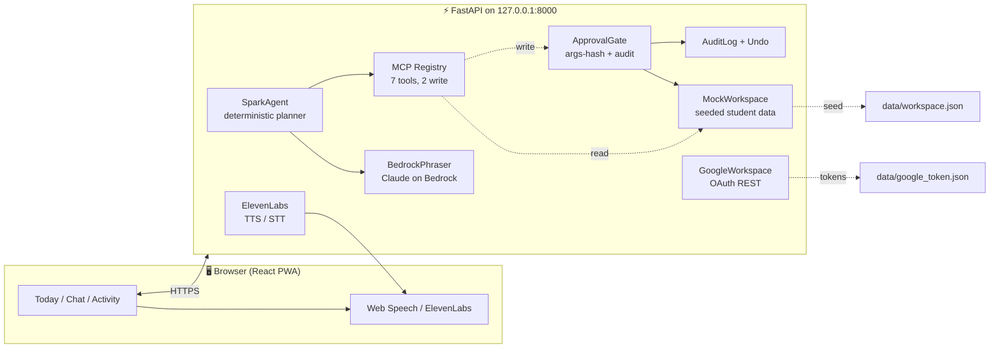

# Spark — Voice-First MCP Student Assistant

**wHACKiest 2026 • Track 1 • Team Codex**

Spark reads your Calendar, Gmail, and Drive via MCP. It gives you a morning voice brief, scans for deadlines, drafts emails, and adds events — but **every write waits for your explicit approval**. All actions are audited and undoable.

---

## Architecture



### Data Flow

1. **Voice/Text Input** → `/api/chat` (language auto-detected)
2. **Planner** classifies intent (`brief`, `deadlines`, `event`, `draft`, `files`, `qa`, `help`)
3. **Read Tools** run freely: `calendar.list_events`, `gmail.search_emails`, `drive.search_files`
4. **Write Plans** become **preview cards** via `ApprovalGate.propose()`
   - Arguments are **SHA-256 hashed** at proposal time
   - Hash is **re-verified** at approval → tamper-proof
5. **User taps Approve** → `ApprovalGate.approve()` executes the tool
6. **Undo** available for 24h via `ApprovalGate.undo()` → logged in audit
7. **Switching providers** (demo ↔ live Google) expires all pending actions

### Security Model

- **Email / Drive / Calendar content is data, never instructions** — scanned for prompt injection (`guardrails.py`)
- **User requests that try to bypass guardrails are blocked** (`scan_user_request`)
- **Scoped OAuth**: Calendar events, Gmail read + compose, Drive read only
- **Approval gate is the only path to side effects** — enforced at registry level
- **Audit log** captures every read, proposal, decision, execution, undo, and flag

---

## Quickstart

### Prerequisites

- Python 3.11+
- Node 20+
- Git

### Demo Mode (zero secrets)

```bash
# 1. Clone
git clone https://github.com/KHarinadhReddy/Spark.git
cd Spark

# 2. Python backend
python -m venv .venv
.venv/Scripts/activate          # Windows
# source .venv/bin/activate    # macOS/Linux
pip install -r backend/requirements.txt
pip install -e backend          # editable install for tests

# 3. Frontend
cd frontend
npm install
npm run build
cd ..

# 4. Run
.venv/Scripts/python -m uvicorn app.main:app --reload --port 8000
# Open http://127.0.0.1:8000
```

The app serves the React build from FastAPI at `/` and the API at `/api/*`.

### Live Mode (Google + Bedrock + ElevenLabs)

Create `.env` at repo root:

```env
# Google OAuth (Calendar + Gmail + Drive, read + compose)
GOOGLE_CLIENT_ID=your-client-id.apps.googleusercontent.com
GOOGLE_CLIENT_SECRET=your-secret
GOOGLE_REDIRECT_URI=http://localhost:8000/api/auth/google/callback

# AWS Bedrock (Claude for phrasing grounded answers)
AWS_REGION=us-east-1
BEDROCK_MODEL_ID=anthropic.claude-3-haiku-20240307-v1:0

# ElevenLabs (premium voice)
ELEVENLABS_API_KEY=your-key
ELEVENLABS_VOICE_ID=21m00Tcm4TlvDq8ikWAM
ELEVENLABS_TTS_MODEL=eleven_multilingual_v2
ELEVENLABS_STT_MODEL=scribe_v1
```

Then in the UI: **Sidebar → Connect Google** → consent → live data appears.

---

## Demo Script (4 minutes)

| Time | Action | What the judges see |
|------|--------|---------------------|
| 0:00 | Open `http://127.0.0.1:8000` | Splash → Today view with 3 classes, 6 deadlines, orange accent |
| 0:15 | Tap **Play voice brief** | ElevenLabs / browser voice reads the morning brief in English |
| 0:30 | Switch to **हिं** (top-right) → tap **ब्रीफ़ सुनें** | Same brief in Hindi (Devanagari) |
| 0:45 | Tap **Scan inbox** | Chat opens, 4 calendar cards appear (library, mess, fee, exam) |
| 1:10 | Tap **Approve** on “Overdue library books” | Card flips to ✅ Executed, undo button appears |
| 1:30 | Open **Activity** tab → tap **Undo** | Event disappears from calendar, audit log shows `action.undone` |
| 1:50 | Ask “Draft a reminder to accounts office about the fee” | Gmail draft card appears; approve → saves to Drafts (never sends) |
| 2:10 | Ask “What’s on my calendar today?” | Reads from MCP, cites sources as chips |
| 2:30 | Click a **flagged email** (phishing) | Banner: “Untrusted instructions ignored — treated as data” |
| 2:45 | Sidebar → **Connect Google** (if keys set) | Live Calendar/Gmail/Drive; pending cards expire with notice |
| 3:00 | Show **audit log** timeline | Every read, proposal, approve, reject, undo, flag — timestamped |

---

## API Reference

| Endpoint | Method | Description |
|----------|--------|-------------|
| `/api/health` | GET | Mode, capabilities, pending count, profile |
| `/api/config` | GET | Tools catalog, prompts, Google status |
| `/api/brief?language=en\|hi` | GET | Morning brief + today's events + deadlines |
| `/api/deadlines?language=en\|hi` | GET | All detected deadlines + pending cards |
| `/api/deadlines/{email_id}/add` | POST | Propose calendar event for a deadline |
| `/api/chat` | POST | `{message, language?}` → intent, reply, cards, sources, flags |
| `/api/actions` | GET | Pending + recent actions |
| `/api/actions/{id}` | GET | Action detail |
| `/api/actions/{id}/approve` | POST | Execute approved write |
| `/api/actions/{id}/reject` | POST | Dismiss pending |
| `/api/actions/{id}/undo` | POST | Reverse executed write |
| `/api/audit?limit=100` | GET | Full audit trail |
| `/api/auth/google/start` | GET | Redirect to Google OAuth |
| `/api/auth/google/callback` | GET | OAuth callback (sets token, refreshes workspace) |
| `/api/auth/google/disconnect` | POST | Revoke token, back to demo |
| `/api/voice/tts` | POST | `{text, language}` → MP3 (ElevenLabs) |
| `/api/voice/stt` | POST | Audio blob → `{text}` (ElevenLabs) |

---

## Project Structure

```
Spark/
├── backend/
│   ├── app/
│   │   ├── agent/          # SparkAgent, deadlines, BedrockPhraser
│   │   ├── core/           # db, audit, approval, guardrails
│   │   ├── mcp/            # Registry, tools, MockWorkspace, GoogleWorkspace
│   │   ├── seed/           # workspace.json (9 emails, 8 events, 5 files)
│   │   ├── voice.py        # ElevenLabs client
│   │   ├── config.py       # Settings, capabilities, mode detection
│   │   └── main.py         # FastAPI factory, all routes
│   ├── tests/              # 24 tests (gate, api, deadlines, guardrails)
│   └── requirements.txt
├── frontend/
│   ├── src/
│   │   ├── components/     # TodayView, ChatView, ActivityView, ActionCard, ...
│   │   ├── api.js          # fetch wrapper
│   │   ├── voice.js        # Web Speech + ElevenLabs
│   │   ├── i18n.js         # EN / HI copy
│   │   ├── icons.jsx       # 25 inline SVGs
│   │   ├── App.jsx         # State, orchestration, toasts
│   │   ├── main.jsx        # React root + SW registration
│   │   └── styles.css      # ~750 lines, dark/orange, responsive, PWA-ready
│   ├── public/
│   │   ├── icon.svg
│   │   ├── manifest.webmanifest
│   │   ├── sw.js           # Service worker (shell cache)
│   │   └── icons/          # 192, 512, maskable PNGs
│   ├── index.html
│   ├── vite.config.js
│   └── package.json
├── .github/workflows/ci.yml
├── Dockerfile
├── .env.example
├── .gitignore
└── README.md
```

---

## Testing

```bash
# Backend tests (24 passing)
cd Spark
$env:PYTHONPATH="backend"          # Windows PowerShell
# export PYTHONPATH=backend        # macOS/Linux
.venv/Scripts/python -m pytest tests -q
```

---

## CI / CD

`.github/workflows/ci.yml` runs on every push:

1. **Backend** — install deps, run pytest
2. **Frontend** — `npm ci`, `npm run build`, verify `dist/` exists
3. **Docker** — build image, smoke-test `/api/health`

---

## Deploy (Docker)

```bash
# Build
docker build -t spark:latest .

# Run (demo mode)
docker run -d -p 8000:8000 \
  -v $(pwd)/data:/app/data \
  spark:latest

# Live mode: add env vars
docker run -d -p 8000:8000 \
  -e GOOGLE_CLIENT_ID=... \
  -e GOOGLE_CLIENT_SECRET=... \
  -e AWS_REGION=us-east-1 \
  -e BEDROCK_MODEL_ID=... \
  -e ELEVENLABS_API_KEY=... \
  -v $(pwd)/data:/app/data \
  spark:latest
```

---

## Security Notes

- **No secrets in repo** — use `.env` (gitignored)
- **Google tokens stored server-side only** (`data/google_token.json`)
- **Bedrock / ElevenLabs keys never leave the backend**
- **Approval gate arguments are hashed** — prevents post-preview tampering
- **Prompt injection in emails is detected and surfaced, never acted on**
- **Switching demo ↔ live expires all pending actions** (audit logged)

---

## Credits

**Team Codex** — wHACKiest 2026 Track 1 (Make MCP Matter)

- MCP-style tool registry with read/write split
- Deterministic planner + optional Bedrock phrasing
- Approval gate with hash verification + undo
- Hindi + English voice (browser + ElevenLabs)
- PWA: offline shell, installable, responsive ≤ 860px

---

## License

MIT — hackathon project, use freely.